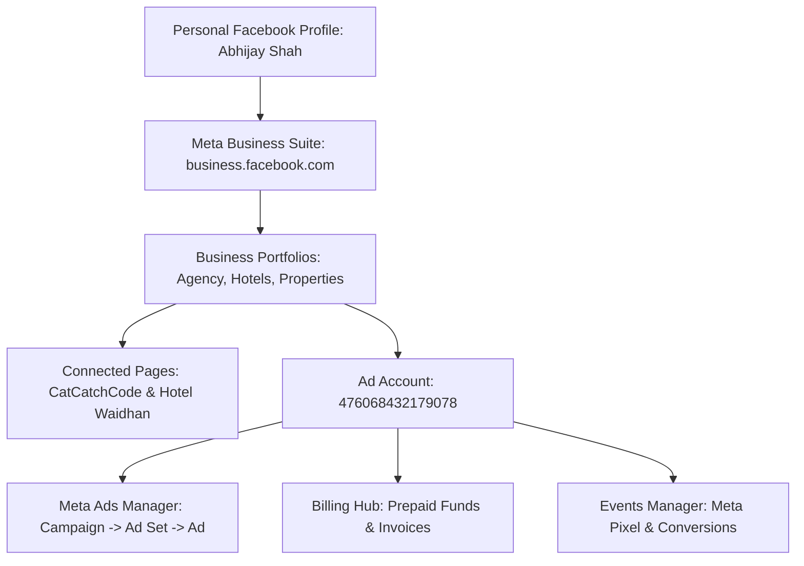

# Meta Ads Masterclass & Visual Dashboard Guide
> **Case Study & Practical Walkthrough:** CatCatchCode Ad Account (`476068432179078`)  
> **Location:** `/Users/abhijayhome/projects/transcript-generate/catcatchcode-ad-abhijay/`  
> **Author:** Antigravity AI  

---

## Table of Contents
1. [The Big Picture: How Meta Advertising Architecture Works](#1-the-big-picture-how-meta-advertising-architecture-works)
2. [Screen-by-Screen Breakdown of All 13 Screenshots](#2-screen-by-screen-breakdown-of-all-13-screenshots)
   - [Screenshot 1: Business Portfolio Switcher](#screenshot-1-business-portfolio-switcher)
   - [Screenshot 2: Meta Business Suite Home (Hotel Waidhan)](#screenshot-2-meta-business-suite-home-hotel-waidhan)
   - [Screenshot 3: Ad Account Linked Pages (Cat Catch Code)](#screenshot-3-ad-account-linked-pages-cat-catch-code)
   - [Screenshot 4: Payment Settings & Available Balance](#screenshot-4-payment-settings--available-balance)
   - [Screenshot 5: Payment Settings Detailed View](#screenshot-5-payment-settings-detailed-view)
   - [Screenshot 6: Payment Activity & Invoices](#screenshot-6-payment-activity--invoices)
   - [Screenshot 7: Global Account-Level Audience Controls](#screenshot-7-global-account-level-audience-controls)
   - [Screenshot 8: Account Overview & Opportunity Score](#screenshot-8-account-overview--opportunity-score)
   - [Screenshot 9: Campaign Creation: Meta AI vs. Manual Setup](#screenshot-9-campaign-creation-meta-ai-vs-manual-setup)
   - [Screenshot 10: Live Campaigns Dashboard (Delivery Status: Ad Set Off)](#screenshot-10-live-campaigns-dashboard-delivery-status-ad-set-off)
   - [Screenshot 11: Live Campaigns Dashboard (Spend & Conversation Results)](#screenshot-11-live-campaigns-dashboard-spend--conversation-results)
   - [Screenshot 12: Account Insights & Performance Trends (CTR & CPC)](#screenshot-12-account-insights--performance-trends-ctr--cpc)
   - [Screenshot 13: Events Manager, Meta Pixel & Ad Approvals](#screenshot-13-events-manager-meta-pixel--ad-approvals)
3. [Deep-Dive Audit of Your Live Ad Campaign](#3-deep-dive-audit-of-your-live-ad-campaign)
4. [How to Run Ads for Different Business Models](#4-how-to-run-ads-for-different-business-models)
   - [Model 1: Service Agencies & IT (CatCatchCode)](#model-1-service-agencies--it-catcatchcode)
   - [Model 2: Local Hotels & Hospitality (Hotel Waidhan Singrauli)](#model-2-local-hotels--hospitality-hotel-waidhan-singrauli)
   - [Model 3: E-Commerce & Retail Brands (9marto / LiveFashion)](#model-3-e-commerce--retail-brands-9marto--livefashion)
   - [Model 4: Healthcare, Clinics & Appointment Bookings](#model-4-healthcare-clinics--appointment-bookings)
5. [The Golden Campaign Checklist & Pro Rules](#5-the-golden-campaign-checklist--pro-rules)

---

## 1. The Big Picture: How Meta Advertising Architecture Works

Before touching any buttons, you must understand how Meta divides its tools. Most beginners get confused because Meta has 4 different control panels:

1. **Personal Profile (`Abhijay Shah`):** The master login. Never run ads directly from your personal wall.
2. **Meta Business Suite (`business.facebook.com`):** The organic management hub for scheduling social posts, checking DMs, and managing your Facebook Page & Instagram account.
3. **Meta Ads Manager (`adsmanager.facebook.com`):** The paid advertising engine. Here you set budgets, build target audiences, and launch campaigns.
4. **Billing Hub & Events Manager:** The backend financial and tracking infrastructure (prepaid balance, GST, Pixels).

---

## 2. Screen-by-Screen Breakdown of All 13 Screenshots

---

### Screenshot 1: Business Portfolio Switcher

* **Original File:** `Screenshot 2026-11-26 at 6.38.10 PM.png`
* **URL:** `adsmanager.facebook.com/adsmanager/billing_hub`
* **What this screen is:** The master multi-business selector.
* **What it shows:**
  * Multiple business portfolios: `Abhijay Shah`, `Comfort Stay PG & Residency | Waidhan`, `Satsang vachan Satsang seva`.
  * Under **Other assets**, your active ad account: `1 ad account (476068432179078)`.
* **Why it matters:** In Meta, a "Business Portfolio" (formerly Business Manager) separates client assets. For example, your agency (**CatCatchCode**) should ideally be in its own portfolio, separate from hospitality businesses (**Hotel Waidhan / Comfort Stay PG**). This ensures budgets, pixels, and client data never get mixed up.

---

### Screenshot 2: Meta Business Suite Home (Hotel Waidhan)

* **Original File:** `Screenshot 2026-11-26 at 6.52.51 PM.png`
* **URL:** `business.facebook.com/latest/home`
* **What this screen is:** The organic social media management cockpit for **Hotel Waidhan Singrauli**.
* **Key Elements on this page:**
  * **Connected Accounts:** Shows both the Facebook Page (`19 followers`) and Instagram Profile (`3 followers`) synced together.
  * **Left Sidebar:**
    * **Notifications & Inbox:** Centralizes Facebook DMs, Instagram DMs, and post comments in one unified inbox.
    * **Planner:** Visual calendar to schedule reels, stories, and feed posts 30 days in advance for free.
    * **Insights:** Shows organic reach and audience demographics.
  * **Action Buttons:** `Create post`, `Boost post`, `Create ad`, `Create reel`.
* **Important Rule:** **Avoid clicking "Boost Post" here!** Always navigate to **Ads Manager** (in the left menu) to create professional ads with real targeting and lower costs.

---

### Screenshot 3: Ad Account Linked Pages (Cat Catch Code)

* **Original File:** `Screenshot 2026-11-26 at 6.52.58 PM.png`
* **URL:** `adsmanager.facebook.com/adsmanager/manage/ad_account_settings/pages`
* **What this screen is:** Ad Account Settings $\rightarrow$ Pages permissions.
* **What it shows:** Your Ad Account (`476068432179078`) is officially connected to the Facebook Page **Cat Catch Code**, and your role is **Page admin**.
* **Why it matters:** An ad account cannot run ads in thin air; every single ad must have a verified Facebook Page identity attached to it. When running ads for CatCatchCode, this page identity will appear at the top of the ad sponsored post.

---

### Screenshot 4: Payment Settings & Available Balance

* **Original File:** `Screenshot 2026-11-26 at 6.37.41 PM.png`
* **URL:** `adsmanager.facebook.com/adsmanager/billing_hub/payment_settings`
* **What this screen is:** The financial engine of your ad account.
* **Crucial Fields Explained:**
  * **Available Funds (₹482.81):** Your current prepaid balance. In India, Meta operates predominantly on a **Prepaid Wallet** model via UPI, NetBanking, or Paytm. When ads run, Meta deducts money from this balance daily. If funds reach ₹0, all active ads immediately pause.
  * **Daily Spending Limit (₹1,908.54):** Meta places a temporary safety ceiling on new ad accounts to prevent fraud. You cannot spend more than ₹1,908.54 in a single 24-hour window right now. As you run ads and maintain a clean payment history, Meta automatically increases this limit to ₹10,000, ₹50,000, and eventually unlimited.
  * **Verify Your Tax Info (GST):** Meta shows an alert asking for your GST number.
    * *If you have a GST number:* Enter it so you can claim 18% Input Tax Credit (ITC).
    * *If you don't have GST yet:* You can safely click **Dismiss**. Meta will simply charge 18% GST on top of your ad spend and pay it to the Indian government.
  * **Business Info:** Shows your billing address in Singrauli (MP) and currency in `INR`.

---

### Screenshot 5: Payment Settings Detailed View

* **Original File:** `Screenshot 2026-11-26 at 6.53.22 PM.png`
* **URL:** `adsmanager.facebook.com/adsmanager/billing_hub/payment_settings?session_id=...`
* **What this screen is:** Detailed payment methods panel showing the green **Available funds** indicator.
* **Pro Tip:** Keep an eye on the notice: *"We'll deduct funds about once a day when you run ads. If funds run out, your ads will be paused."* When running active campaigns, ensure you add ₹500–₹1,000 via UPI so campaigns don't stop abruptly.

---

### Screenshot 6: Payment Activity & Invoices

* **Original File:** `Screenshot 2026-11-26 at 6.38.00 PM.png`
* **URL:** `adsmanager.facebook.com/adsmanager/billing_hub/payment_activity`
* **What this screen is:** The statement of accounts.
* **What it shows:** Filtered between Nov 20 and Nov 26, 2026. Shows "No transactions" during this specific 6-day window because no funds were added or billed during these exact dates.
* **How to use it:** Whenever you need an official GST tax invoice for your accountant, change the date filter to "Lifetime" or "This Month", click on any transaction, and download the PDF receipt.

---

### Screenshot 7: Global Account-Level Audience Controls

* **Original File:** `Screenshot 2026-11-26 at 6.48.43 PM.png`
* **URL:** `adsmanager.facebook.com/adsmanager/manage/advertising_settings`
* **What this screen is:** Account-wide guardrails. Any rule you set here will apply to **ALL** future campaigns created in this account.
* **Features on this screen:**
  * **Specific Locations (Include / Exclude):** If your business only operates in India, you can lock your ad account so no campaign ever accidentally advertises outside India.
  * **Age-Restricted Goods (Set to Minimum Age 25):** Notice on your screen: *"We'll only show ads to people on WhatsApp whose age is known to be 25 or older."*
    * **Strategic Note:** For B2B web development services (CatCatchCode), setting minimum age to 24–25 is a smart move because business owners with budgets are rarely under 24.
  * **Brand Suitability Exclusions:** Prevents your ads from showing next to sensitive news, violence, or adult content.

---

### Screenshot 8: Account Overview & Opportunity Score

* **Original File:** `Screenshot 2026-11-26 at 6.50.59 PM.png`
* **URL:** `adsmanager.facebook.com/adsmanager/manage/accounts`
* **What this screen is:** High-level health monitor for your ad account.
* **Key Data Points:**
  * **Opportunity Score (100):** Meta rates how well you follow their automated best practices. A score of 100 means your account has no critical policy warnings.
  * **Account Spending Limit Status:** Shows ₹184.05 spent out of ₹593.21 total account cap.
  * **Campaign Trends:** Displays rolling 7-day performance charts.

---

### Screenshot 9: Campaign Creation: Meta AI vs. Manual Setup

* **Original File:** `Screenshot 2026-11-26 at 6.51.13 PM.png`
* **What this screen is:** The gateway to launching any new campaign.
* **The 2 Choices Explained:**
  1. **Meta AI-guided setup (Beta):** Lets you write a prompt like: *"Create an ad for web design with ₹300 daily budget"*.
     * **Drawback:** Meta AI often turns on broad targeting, selects expensive placements (like Audience Network), and removes your granular control.
  2. **Manual campaign setup (RECOMMENDED):** You manually choose the objective (Engagement, Leads, Sales), select WhatsApp, define exact age brackets, and set placement rules. **Always pick Manual campaign setup for serious campaigns!**

---

### Screenshot 10: Live Campaigns Dashboard (Delivery Status: Ad Set Off)

* **Original File:** `Screenshot 2026-11-26 at 6.51.44 PM.png`
* **URL:** `adsmanager.facebook.com/adsmanager/manage/campaigns`
* **What this screen shows:**
  * **Campaign Name:** `CCC_Website_Development_WhatsApp_India_N...` (Toggle switch is blue/ON).
  * **Delivery Column:** `Ad set off` (Gray Dot). This tells you that even though the Campaign is toggled ON, the underlying Ad Set is paused/off!
  * **Actions & Drafts:** Notice the top right button **`Review and publish (1)`** and **`Discard drafts`**. This means you edited this campaign and saved a draft, but haven't published it yet.

---

### Screenshot 11: Live Campaigns Dashboard (Spend & Conversation Results)

* **Original File:** `Screenshot 2026-11-26 at 6.51.55 PM.png`
* **URL:** `adsmanager.facebook.com/adsmanager/manage/campaigns`
* **What this screen shows (The Core Numbers):**
  * **Results:** **2 Messaging conversations**
  * **Cost per result:** **₹92.03** per messaging conversation
  * **Amount spent:** **₹184.05**
  * **Impressions:** **1,209**
  * **Reach:** **1,107**
  * **Ends:** `Ongoing`
  * **Attribution setting:** `7-day click or 1-day view`
  * **Bid strategy:** `Highest volume`

---

### Screenshot 12: Account Insights & Performance Trends (CTR & CPC)

* **Original File:** `Screenshot 2026-11-26 at 6.47.05 PM.png`
* **URL:** `adsmanager.facebook.com/adsmanager/reporting/account_insights`
* **What this screen is:** In-depth analytical reporting for past campaigns over the last 30 days.
* **The 4 Key KPI Cards:**
  1. **Reach (1.1K):** Exactly 1,107 unique people saw your ad.
  2. **Frequency (1.1):** On average, each person saw your ad 1.1 times. (A frequency between 1.0 and 2.0 is ideal for cold audiences).
  3. **CTR (all) (1.3%):** Click-Through Rate. Out of 100 people who saw your ad, 1.3 clicked on it. In the Indian digital services industry, **a CTR above 1.0% is considered good and healthy!**
  4. **CPC (Cost Per Link Click) (₹14.16):** You paid approximately ₹14 for each person who clicked your link.
* **Creative Insights (Bottom):**
  * **Creative Fatigue:** Shows whether your audience is tired of seeing the same image. Yours shows *"None of your ad sets include fatigued creative"*.
  * **Creative Diversity:** Confirms whether you are testing different visual styles.

---

### Screenshot 13: Events Manager, Meta Pixel & Ad Approvals

* **Original File:** `Screenshot 2026-11-26 at 6.50.34 PM.png`
* **URL:** `eventsmanager.facebook.com/events_manager2/overview`
* **What this screen is:** A split view showing your **Ad Approval History** and **Conversions API / Pixel Setup**.
* **Key Observations:**
  * **Ad Approval History:** Shows 6 previous ads approved for Cat Catch Code with the visual creative: **`WEBSITE IN 5-7 DAYS - ₹15,000`**. This proves your ad creatives comply with Meta's advertising policies.
  * **Conversions API (CAPI) / Meta Pixel:** The background shows the tool to track website visitor events (`PageView`, `AddToCart`, `Purchase`, `Lead`). If you want to track leads on your website `catcatchcode.com`, you place this code in your site header.

---

## 3. Deep-Dive Audit of Your Live Ad Campaign

In Screenshot `10-campaigns-dashboard-results.png`, you have live campaign performance data for:  
**Campaign Name:** `CCC_Website_Development_WhatsApp_India_N...`

Here is the exact analysis of your results:

| Metric | Your Actual Value | What it Means & Benchmark |
| :--- | :--- | :--- |
| **Total Amount Spent** | **₹184.05** | Total ad spend consumed before the ad stopped. |
| **Results** | **2 Messaging Conversations** | **2 real people** tapped your ad and started a chat with CatCatchCode. |
| **Cost Per Result** | **₹92.03 / message** | You paid ₹92 per qualified business inquiry. For high-ticket services (where a website sells for ₹15,000 to ₹35,000), paying ₹92 per inquiry gives an **insane ROI** if you close even 1 out of 10 leads! |
| **Impressions** | **1,209** | Total times your ad was displayed on screen. |
| **Reach** | **1,107** | Number of unique individuals who saw the ad. |
| **CTR (Click-Through Rate)** | **1.3%** | Healthy! Means your "Website in 5-7 Days ₹15,000" creative caught attention. |
| **Delivery Status** | **`Ad set off` (Gray Dot)** | The campaign is currently **paused/stopped** because the ad set switch is toggled OFF. |
| **Draft Indicator** | **`Review and publish (1)`** | You made an edit to this campaign that has not yet been submitted to Meta. |

### How to Restart & Scale This Campaign:
1. Click the blue **`Review and publish (1)`** button at the top right to push your saved edits live.
2. In the **Off/On** column, toggle the switch from gray to **blue**.
3. Since your available balance is **₹482.81**, you have enough funds to run this ad for another 2 days at ₹200/day.

---

## 4. How to Run Ads for Different Business Models

Your account manages multiple assets (an IT agency like **CatCatchCode** and a hospitality brand like **Hotel Waidhan Singrauli**). The ad strategy for each is completely different:

---

### Model 1: Service Agencies & IT (CatCatchCode)
* **Goal:** High-ticket client acquisition (Websites from ₹15k, MIS software from ₹35k).
* **Best Campaign Objective:** **`Engagement` (Messaging Apps - WhatsApp & Instagram DM)**.
* **Audience Strategy:**
  * **Location:** India (or target major commercial hubs: Mumbai, Delhi NCR, Bangalore, Pune, Ahmedabad, Hyderabad).
  * **Age:** 24 – 50.
  * **Detailed Targeting:** Small business owners, Business page admins, Entrepreneurship, Shopify, E-commerce.
* **Ad Creatives:**
  * Direct price transparency: *"Custom Business Websites in 5 Days - Starting ₹15,000"*.
  * Contrast ads: "Slow WordPress templates vs. Lightning-fast Next.js code".
* **Call to Action:** `Send WhatsApp Message`.

---

### Model 2: Local Hotels & Hospitality (Hotel Waidhan Singrauli)
* **Goal:** Room bookings, banquet hall inquiries, restaurant visits, corporate travel stays.
* **Best Campaign Objective:** **`Leads` (Direct Phone Calls)** OR **`Engagement` (WhatsApp Inquiries)**.
* **Audience Strategy (Hyper-Local Radius):**
  * **Location:** Drop a pin on Waidhan / Singrauli with a **15–30 km radius**, PLUS target frequent travelers arriving from nearby industrial cities (Varanasi, Rewa, Ranchi).
  * **Detailed Targeting:** Frequent travelers, Business travelers, Hotel, Wedding planner (for banquet hall).
* **Ad Creatives:**
  * Clean, high-resolution photos of AC rooms, clean bathrooms, and exterior facade (as seen in your banner in screenshot `11-meta-business-suite-hotel-waidhan.png`).
  * Highlight key amenities: *"Clean AC Rooms, 24x7 Hot Water, Free High-Speed WiFi, Prime Location in Waidhan"*.
  * Pricing hook: *"Rooms starting at just ₹999/night | Call for corporate discounts"*.
* **Call to Action:** `Call Now` (Direct phone call to `7879028316`).

---

### Model 3: E-Commerce & Retail Brands (9marto / LiveFashion)
* **Goal:** Direct online orders and sales on website.
* **Best Campaign Objective:** **`Sales`** (requires Meta Pixel installed on Shopify/website).
* **Audience Strategy:**
  * Broad targeting or Advantage+ audience with interest in fashion/online shopping.
* **Ad Creatives:**
  * Carousel ads showing 5–10 trending products with prices.
  * Short-form 9:16 vertical video (Instagram Reel) showing unboxing or fabric quality.
* **Call to Action:** `Shop Now`.

---

### Model 4: Healthcare, Clinics & Appointment Bookings
* **Goal:** Patients booking consultations with doctors/dentists.
* **Best Campaign Objective:** **`Leads` (Instant Forms)** or **`Engagement` (WhatsApp Appointment Booking)**.
* **Audience Strategy:**
  * Hyper-local 5–10 km radius around the clinic.
* **Ad Creatives:**
  * Doctor introducing common symptoms and treatments.
  * "Book your dental checkup online & skip the waiting line".
* **Call to Action:** `Book Now`.

---

## 5. The Golden Campaign Checklist & Pro Rules

1. **The 48-Hour Learning Rule:** Never edit an ad within the first 24 to 48 hours of launch. Let Meta's machine learning find the lowest-cost buyers.
2. **Watch the Prepaid Balance:** Always keep at least ₹500 in your prepaid wallet. If balance hits ₹0, Meta halts ad delivery, which resets the learning algorithm.
3. **Never Click "Boost Post" on Mobile:** Always build campaigns inside **Ads Manager** (`adsmanager.facebook.com`) on desktop.
4. **Use Proper Dimensions:**
   * Feed ads: `1080 x 1080 px` (1:1 Square).
   * Reels & Stories: `1080 x 1920 px` (9:16 Vertical).
5. **Always Set an End Date:** When launching a test campaign, always check "Set an end date" (e.g. 4 days) to prevent unexpected overspending.
