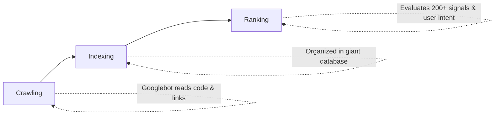
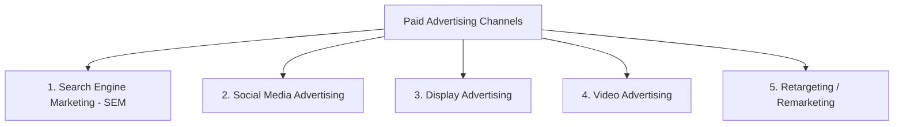
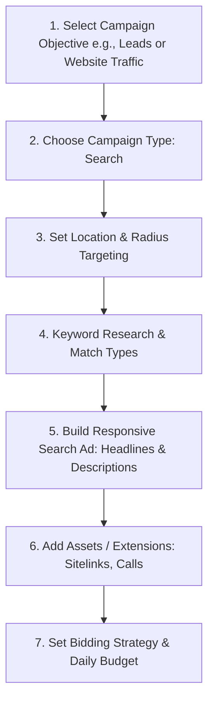
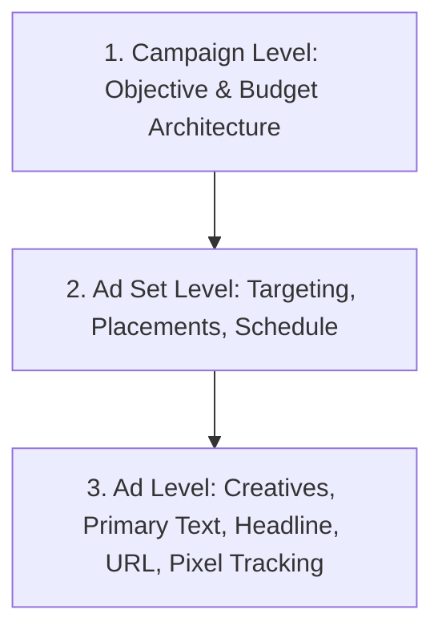
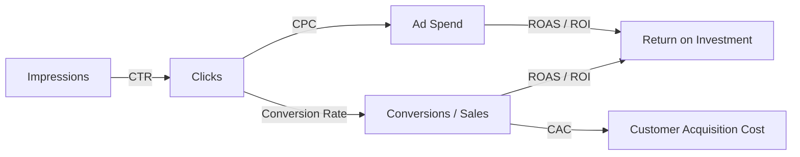
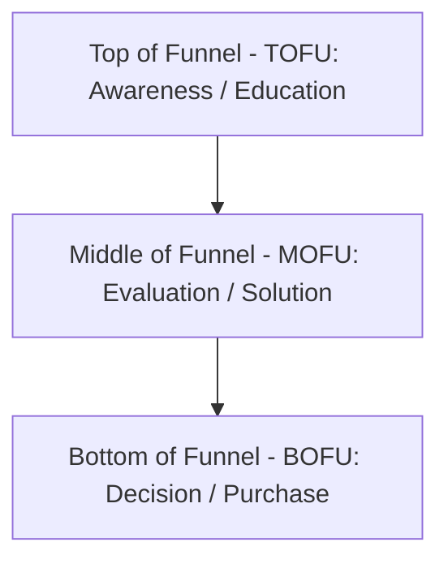
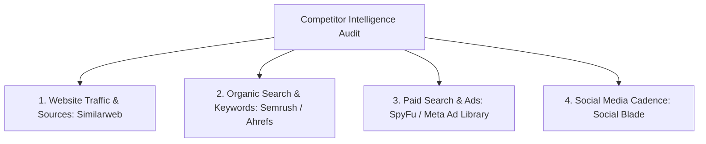

# Digital Marketing with AI: Complete Masterclass Notes (2025 Edition)
> **Source:** WsCube Tech — *Digital Marketing with AI Full Course for Beginners in 4 HOURS [No Experience Needed]*  
> **Course Instructor:** Harmeet (WsCube Tech)  
> **Total Duration Covered:** 4 Hours 17 Minutes (Full 5,298-line transcript synthesized)  
> **Purpose of this Document:** Complete, self-contained study notes and execution blueprint designed to give you 100% of the knowledge, frameworks, AI prompts, tools, formulas, and actionable workflows from the course without needing to watch the video.

---

## Table of Contents
1. [Module 1: Digital Marketing Fundamentals & Core Concepts](#module-1-digital-marketing-fundamentals--core-concepts)
2. [Module 2: Search Engine Optimization (SEO) Masterclass & AI Integration](#module-2-search-engine-optimization-seo-masterclass--ai-integration)
3. [Module 3: Local SEO & Google Business Profile (GBP) Optimization](#module-3-local-seo--google-business-profile-gbp-optimization)
4. [Module 4: Paid Marketing (SEM / PPC) Fundamentals](#module-4-paid-marketing-sem--ppc-fundamentals)
5. [Module 5: Google Ads (Search Ads Campaign Setup & Optimization)](#module-5-google-ads-search-ads-campaign-setup--optimization)
6. [Module 6: Meta Ads (Facebook & Instagram Ads Manager)](#module-6-meta-ads-facebook--instagram-ads-manager)
7. [Module 7: LinkedIn Marketing & B2B Advertising](#module-7-linkedin-marketing--b2b-advertising)
8. [Module 8: High-Converting Ad Copywriting & Creatives with AI](#module-8-high-converting-ad-copywriting--creatives-with-ai)
9. [Module 9: Performance Marketing Metrics & Unit Economics](#module-9-performance-marketing-metrics--unit-economics)
10. [Module 10: Content Marketing & Strategic Brand Building](#module-10-content-marketing--strategic-brand-building)
11. [Module 11: Social Media Marketing (SMM) Strategy & Management](#module-11-social-media-marketing-smm-strategy--management)
12. [Module 12: Strategic Marketing, Competitor Analysis & Funnels](#module-12-strategic-marketing-competitor-analysis--funnels)
13. [Module 13: AI-Powered Resume Building & Marketing Interview Blueprint](#module-13-ai-powered-resume-building--marketing-interview-blueprint)
14. [Master Cheat Sheet: Tools, Formulas & Prompt Vault](#master-cheat-sheet-tools-formulas--prompt-vault)

---

## Module 1: Digital Marketing Fundamentals & Core Concepts
*Video Timestamp: 0:01 – 18:54*

### 1. What is Marketing vs. Digital Marketing?
* **Marketing:** The strategic process of presenting, promoting, and positioning a product, service, brand, individual, or idea in front of potential customers so that it solves their problems and demonstrates superior value over competitors. Marketing applies not only to goods but also to celebrities (PR management), political parties (election narrative), and educational institutions.
* **Digital Marketing (Internet Marketing):** Executing all promotional, relationship-building, and sales activities using the internet and digital platforms (search engines, social media networks, websites, mobile apps, email, messaging).

### 2. Traditional Marketing vs. Digital Marketing: The Deep Breakdown
The instructor illustrates the difference using the classic **Billboard / Hoarding Example**:

| Evaluation Metric | Traditional Marketing (e.g., Highway Hoarding) | Digital Marketing (e.g., Google / Meta Ads) |
| :--- | :--- | :--- |
| **Cost & Minimum Entry** | High upfront commitment (₹25,000 to ₹2,00,000+ per month depending on prime location). | Ultra-low entry barrier (Start with ₹100 – ₹500/day). |
| **Audience Targeting** | Mass spray-and-pray. Cannot filter by age, gender, exact interest, or purchase intent. | Laser-sharp precision. Target by age (e.g., 18–30), gender, city, GPS radius (e.g., 5 km), search intent, behavior. |
| **Measurability & Tracking** | Zero data. Agency claims "1 lakh cars pass daily," but you cannot know how many saw it, remembered it, or took action. | 100% data-driven. Real-time impressions, unique reach, clicks, conversions, time on site, and purchase value. |
| **Flexibility / Control** | Zero flexibility. Once printed and mounted, you cannot modify text, change photos, or pause mid-month without penalty. | Total real-time control. Pause, edit headlines, change images, reallocate budget, or run A/B split tests with one click. |
| **Scale & Reach** | Restricted to one physical geography. | Local, national, or worldwide scale instantly. |

### 3. The 7 Core Pillars of Digital Marketing
1. **Search Engine Optimization (SEO):** Organic visibility on search engines without paying per click.
2. **Search Engine Marketing (SEM / PPC):** Paid search ads displayed above organic results when high intent exists.
3. **Social Media Marketing (SMM) & Optimization (SMO):** Organic content and paid ads across Meta, LinkedIn, X, Pinterest, YouTube.
4. **Content Marketing:** Creating educational and valuable written, video, or audio content to pull customers inward.
5. **Email & Direct Messaging Marketing:** Direct, high-ROI communication with owned leads and existing customers.
6. **Affiliate & Influencer Marketing:** Partnering with third parties and creators to leverage their established trust.
7. **Analytics & Data-Driven Optimization:** Tracking performance metrics to continuously eliminate waste and maximize ROI.

### 4. Why Digital Marketing is in Massive Demand (2025)
* Consumer behavior has permanently migrated online (users research before buying anything from salon services to college degrees).
* Businesses that fail to establish digital visibility lose market share to competitors who do.
* Multi-channel career opportunities: Corporate in-house marketer, digital agency specialist, freelance consultant, e-commerce brand owner, or affiliate entrepreneur.

---

## Module 2: Search Engine Optimization (SEO) Masterclass & AI Integration
*Video Timestamp: 18:54 – 1:10:55*

SEO is the practice of optimizing your website and content to rank on Page 1 of Search Engine Results Pages (SERPs) organically.

### 1. How Search Engines Work
Search engines (Google, Bing) operate in three sequential stages:

1. **Crawling:** Automated software bots (Googlebot / spiders) discover web pages by following hyperlinks across the web.
2. **Indexing:** Google analyzes the text, media files, and code of crawled pages, storing and categorizing them in a massive global database (the Google Index).
3. **Ranking:** When a user types a query, Google algorithms instantly evaluate indexed pages against hundreds of ranking signals (relevance, authority, page speed, mobile usability, search intent) to serve the best results.

---

### 2. Keyword Research Blueprint
Keywords are the queries and phrases users enter into search engines.

#### A. Keyword Length Classifications
* **Short-Tail (Head) Keywords (1–2 words):** e.g., *"Shoes"*, *"Digital Marketing"*.
  * High search volume, intense competition, low intent, low conversion rate.
* **Mid-Tail Keywords (2–3 words):** e.g., *"Digital Marketing Course"*, *"Running Shoes For Men"*.
  * Moderate volume, moderate competition.
* **Long-Tail Keywords (4+ words):** e.g., *"Best digital marketing course in Jaipur with placement assistance"*.
  * Lower individual search volume, low competition, highly specific search intent, highest conversion rate.

#### B. The 4 Categories of Search Intent
1. **Informational:** User wants knowledge (e.g., *"What is on-page SEO?"*).
2. **Navigational:** User wants a specific site or page (e.g., *"WsCube Tech login"*).
3. **Commercial Investigation:** User is comparing options before buying (e.g., *"Best digital marketing institutes review"*).
4. **Transactional:** User is ready to buy/enroll (e.g., *"Buy digital marketing course online"*).

#### C. Keyword Research Tools
* **Google Keyword Planner:** Free tool inside Google Ads showing historical search volumes and bidding ranges.
* **Ubersuggest:** Keyword suggestions, search volume, SEO difficulty, and competitor keywords.
* **Semrush / Ahrefs:** Comprehensive keyword metrics, search intent badges, and SERP gap analysis.
* **AnswerThePublic:** Visualizing user questions (What, Why, Where, How, Who).

---

### 3. On-Page SEO Checklist
On-page SEO covers optimizations executed directly within your website code and content.

#### A. Title Tag Optimization (The Most Crucial Tag)
* **Pixel Width & Character Count:** Keep within **50–60 characters** (approx. **580 pixels**) so Google doesn't truncate the title with an ellipsis (`...`).
* **Formula:** `Primary Keyword - Secondary Benefit / Hook | Brand Name`
* **Example:** `Digital Marketing Course Online with Placement | WsCube Tech`
* Place primary keywords as close to the beginning as possible.

#### B. Meta Description
* **Pixel Width & Character Count:** Keep within **150–160 characters** (approx. **920 pixels**).
* While not a direct ranking factor, it directly impacts **Click-Through Rate (CTR)**.
* **Formula:** Problem statement + Solution summary + Clear Call-to-Action (CTA).
* **Example:** `Master digital marketing with hands-on live projects, SEO, Google Ads & AI tools. Get 100% placement support. Enroll in our free 2-day demo today!`

#### C. URL Structure Best Practices
* Short, readable, lowercase, words separated by hyphens (`-`).
* Avoid stop words (`a`, `the`, `in`, `and`) and dynamic query parameters (`?id=452`).
* **Good:** `https://example.com/digital-marketing-course`
* **Bad:** `https://example.com/category/post_id?4521=var`

#### D. Heading Hierarchy (H1 to H6)
* **H1 Tag:** Exactly **ONE** H1 per page containing the primary keyword.
* **H2 Tags:** Major sub-sections (secondary keywords).
* **H3–H6 Tags:** Minor nested subsections, FAQs, lists.

#### E. Content Optimization & Keyword Density
* Aim for a natural keyword density of **1% to 2%** (mention primary keyword 1–2 times per 100 words).
* **Avoid Keyword Stuffing:** Repeating words unnaturally triggers Google spam penalties.
* Incorporate **LSI (Latent Semantic Indexing)** and semantically related terms (e.g., if targeting *Digital Marketing*, include *SEO, PPC, social media strategy, analytics, ROI*).

#### F. Image SEO
* **Descriptive File Names:** Rename `IMG_9042.jpg` to `digital-marketing-framework.webp`.
* **Image Alt Text:** Provide descriptive alternative text for search bots and screen readers (e.g., `alt="Instructor explaining digital marketing campaign workflow"`).
* **Next-Gen Formats:** Use WebP or AVIF and compress images to maintain fast page load speed.

---

### 4. Technical SEO & Google Search Console (GSC)

#### A. What is Google Search Console (formerly Webmaster Tools)?
A free platform provided by Google that allows webmasters to monitor indexing status, submit sitemaps, view organic search queries, track impressions and CTR, and fix technical crawl errors.

#### B. Adding and Verifying a Property
* **Domain Property:** Covers all subdomains (`m.example.com`, `blog.example.com`) and protocols (`http`, `https`). Requires DNS TXT record verification at your domain registrar.
* **URL-Prefix Property:** Covers only the specified URL format (`https://www.example.com`). Supports:
  1. **HTML Tag:** Pasting a `<meta name="google-site-verification" content="..." />` into the `<head>` section of your site.
  2. **HTML File Upload:** Uploading a Google-provided `.html` file to your server root.
  3. **Google Analytics / Google Tag Manager link.**

#### C. XML Sitemap (`sitemap.xml`)
* A roadmap file listing all indexable URLs on your site with metadata (last updated date, priority).
* Generated automatically on CMS platforms via plugins like **Rank Math**, **Yoast SEO**, or **AIOSEO**.
* **Submission in GSC:** Navigate to *Sitemaps* menu -> type `sitemap.xml` -> click *Submit*.

#### D. Robots.txt
* A text file placed at `example.com/robots.txt` that instructs search engine web crawlers which URLs they can or cannot crawl.
```txt
User-agent: *
Disallow: /admin/
Disallow: /checkout/
Allow: /
Sitemap: https://example.com/sitemap.xml
```

#### E. Core Web Vitals & Page Experience
* **LCP (Largest Contentful Paint):** Loading speed of main content (< 2.5s).
* **INP (Interaction to Next Paint):** Interactivity responsiveness (< 200ms).
* **CLS (Cumulative Layout Shift):** Visual stability during page load (< 0.1).
* **HTTPS Security:** SSL certificate installed.

---

### 5. Off-Page SEO & Backlinks
* **Backlink:** An incoming hyperlink from an external domain to your website. Google treats backlinks as "votes of confidence."
* **Domain Authority (DA) / Page Authority (PA):** Metric (developed by Moz/Ahrefs) predicting ranking strength on a scale of 1–100.
* **DoFollow vs. NoFollow:**
  * `rel="dofollow"`: Passes link equity (PageRank) to the destination.
  * `rel="nofollow"`: Instructs search bots not to endorse or pass ranking credit to the destination link.
* **Effective Link Building Tactics:**
  * High-value guest blogging on authoritative niche sites.
  * Broken link building (finding dead links on authority sites and suggesting your content as a replacement).
  * Digital PR and industry interviews.
  * Creating linkable assets (original research, industry benchmarks, comprehensive calculators, free tools).
* **Black Hat Warning:** Avoid Private Blog Networks (PBNs), automated link-blasting software, and buying links. They risk manual Google penalties and de-indexing.

---

### 6. AI in SEO: Practical Prompt Engineering
The instructor demonstrates how to turn ChatGPT from a generic text generator into a specialized SEO assistant.

#### A. Prompt for Keyword Intent Discovery & Topic Clustering
```text
Act as a Senior SEO Strategist. 
Here is a description of my service/landing page: [Paste Page Content/Description].
Analyze this and generate:
1. Top 5 Primary Keywords with commercial/transactional intent.
2. 10 Long-Tail Keywords phrased as user queries.
3. 5 FAQ questions people ask before purchasing this service.
Group these keywords by user search intent (Informational, Commercial, Transactional).
```

#### B. Prompt for Pixel-Perfect Meta Titles & Descriptions
```text
Act as an On-Page SEO Copywriter.
Target Keyword: [Your Keyword]
Target Page Topic: [Page Topic]
Brand Name: [Brand]

Generate 5 distinct Title Tags and Meta Descriptions.
Rules:
- Title Tags MUST be between 50 and 60 characters (max 580 pixels).
- Meta Descriptions MUST be between 140 and 155 characters (max 920 pixels).
- Include the primary keyword near the beginning.
- End each meta description with an actionable CTA hook.
```

#### C. Prompt for JSON-LD FAQ Schema Markup
```text
Generate valid JSON-LD FAQ Schema code for the following 4 Questions and Answers:
Q1: [Question 1] - A1: [Answer 1]
Q2: [Question 2] - A2: [Answer 2]
Q3: [Question 3] - A3: [Answer 3]
Q4: [Question 4] - A4: [Answer 4]
Ensure it passes Google's Rich Results validation test. Output only valid JSON inside a script tag.
```

#### D. Prompt for Monthly SEO Client Reporting
```text
Act as an SEO Account Manager.
I am providing monthly SEO performance data for my client:
- Organic Impressions: 145,000 (+18% MoM)
- Organic Clicks: 7,200 (+14% MoM)
- Top Ranking Keywords: [List 5 Keywords]
- Conversions / Leads Generated: 120 (+9% MoM)

Write a concise, professional Executive Summary for the client highlighting key wins, performance insights, and 3 strategic recommendations for next month's campaign.
```

---

## Module 3: Local SEO & Google Business Profile (GBP) Optimization
*Video Timestamp: 1:10:55 – 1:26:35*

Local SEO focuses on ranking businesses for geographically constrained searches (e.g., *"salon near me"*, *"plumber in Bhopal"*, *"interior designer in Bangalore"*).

### 1. The Local Competitor Reverse-Engineering Method
The instructor demonstrates how to uncover every platform sending traffic to top local competitors:
1. Search your service and city: e.g., `Salon services in Bhopal`.
2. Look at the top local pack / map results and identify the market leader (e.g., *"Beauty on Duty"*).
3. Search the competitor's exact brand name in quotes on Google: `"Beauty on Duty" "Bhopal"`.
4. Inspect the search results to find every local citation and directory listing they have built:
   * **National & Local Directories:** Justdial, Sulekha, IndiaMART, TradeIndia, BharatBiz.
   * **Social Directories:** Facebook Places, Instagram Local, LinkedIn Company.
5. Create business listings on all of the same directories for your own client.

### 2. Google Business Profile (GBP / GMB) Optimization Blueprint
1. **Business Name:** Use your legal/actual business name. *Never keyword-stuff the name* (e.g., writing "John Salon - Best Cheap Haircut Bhopal" risks instant suspension).
2. **Primary Category:** The #1 ranking factor in Google Maps. Choose the single most specific primary category (e.g., *"Hair Salon"*, not just *"Business"*). Add relevant secondary categories.
3. **Address & Service Area:**
   * Storefront: Displays full street address and pin on map.
   * Service Area Business (SAB): Hides physical address if you travel to customers (e.g., mobile repair, home cleaning) and defines geographic radius/pin codes.
4. **Verification:** Complete verification via phone SMS, email, video verification (showing street signage and equipment), or postal postcard.
5. **NAP Consistency (Name, Address, Phone):** Your business name, street address, and phone number must be identical down to capitalization and punctuation across your website, Google Business Profile, and all local directories. Inconsistent NAP data confuses Google's algorithm and drops local rankings.
6. **Operating Hours:** Keep hours accurate, including holiday hours.
7. **High-Quality Visual Assets:** Regularly upload real photos of:
   * Exterior (storefront and signage so customers recognize you).
   * Interior workspace and team at work.
   * Products, completed client work, before-and-after transformations.
8. **Google Posts & Updates:** Post weekly updates regarding offers, seasonal discounts, events, and tips with a "Call Now" or "Book" CTA.
9. **Review & Reputation Management Strategy:**
   * Proactively request reviews from satisfied clients using a short Google Review link.
   * Respond to 100% of reviews (both positive and negative) within 24–48 hours.
   * Naturally incorporate local service keywords into your responses (e.g., *"Thank you Priya! We are glad you loved our bridal makeover service in Bhopal"*).

---

## Module 4: Paid Marketing (SEM / PPC) Fundamentals
*Video Timestamp: 1:26:35 – 1:42:23*

### 1. Organic vs. Paid Marketing
* **Organic (SEO / Social Media):** Zero direct ad cost, compounds over time, builds sustainable long-term authority. *Disadvantage:* Takes 3 to 6+ months to gain traction.
* **Paid Advertising (PPC):** Pay to capture attention immediately. Results can begin within 24 hours. Ideal for new product launches, time-sensitive sales, seasonal promotions, and rapid lead acquisition.

### 2. The 5 Core Categories of Paid Advertising


1. **Search Engine Marketing (SEM / Google Search Ads):**
   * High-intent, pull-based advertising.
   * Ads appear on search engines when users actively search for solutions (e.g., *"hire tax consultant"*). Marked with a **Sponsored** tag.
2. **Social Media Advertising (Meta, LinkedIn, Instagram):**
   * Disruption / push-based advertising.
   * Users browse their feed for entertainment or networking; your visually captivating ad disrupts their flow with a relevant offer.
3. **Display Advertising (Google Display Network - GDN):**
   * Visual banners (static or animated) displayed across millions of third-party websites, news portals, and blogs.
   * Excellent for top-of-funnel brand recall and awareness. Webmasters monetize through Google AdSense.
4. **Video Advertising (YouTube Ads):**
   * Formats: Skippable in-stream ads (5s skip rule), non-skippable 15s ads, bumper ads (6s non-skippable), in-feed video ads.
   * Highest emotional engagement and conversion potential for storytelling.
5. **Retargeting / Remarketing Ads:**
   * Tracking users who previously visited your website, added an item to cart, or engaged with your social profile, and serving them tailored follow-up ads across the internet to bring them back to convert.

---

## Module 5: Google Ads (Search Ads Campaign Setup & Optimization)
*Video Timestamp: 1:42:23 – 2:02:40*

Google Ads is the world's largest pay-per-click advertising platform, auctioning ad space in milliseconds based on keyword bids and ad quality.

### 1. Google Ads Search Campaign Setup Workflow


1. **Campaign Objective:** Choose *Leads*, *Website Traffic*, *Sales*, or *Create a campaign without guidance*.
2. **Campaign Type:** Choose *Search* (text ads on SERP).
3. **Conversion Action:** Define what success looks like (Phone Calls, Contact Form Submission, WhatsApp click, E-commerce Purchase).
4. **Geographic Targeting:**
   * Country, State, City, or **Radius Targeting** (e.g., 5 to 15 km around a physical office for local service businesses).
5. **Languages:** Select languages your target audience speaks (e.g., English, Hindi).

### 2. Keyword Match Types & Negative Keywords
Match types determine how closely a user's search query must match your target keyword:

| Match Type | Syntax | Behavior & Trigger Condition | Example Search Query Match |
| :--- | :--- | :--- | :--- |
| **Broad Match** | `digital marketing course` | Triggers on related searches, synonyms, typos, or variations. Highest volume, lowest control. | *"online internet advertising classes"* |
| **Phrase Match** | `"digital marketing course"` | Triggers when the core meaning of your phrase is preserved within the search query. | *"best digital marketing course in india"* |
| **Exact Match** | `[digital marketing course]` | Triggers only on the exact term or very close grammatical variants with the exact same intent. | *"digital marketing course"* |
| **Negative Keywords** | `-free`, `-jobs`, `-salary` | **Crucial:** Prevents ads from displaying when these terms are included in queries. Saves 20–40% wasted ad spend. | Blocks *"free digital marketing course"* |

### 3. Responsive Search Ads (RSA) Architecture
* **Final URL:** The destination landing page where users arrive after clicking.
* **Display Path:** Two customizable 15-character vanity URL slugs (e.g., `example.com/Digital-Marketing/Course`) to increase relevance.
* **Headlines (Up to 15 Headlines, 30 chars each):** Google shuffles and tests headline combinations automatically using machine learning.
  * *Tip:* Include primary keywords in at least 3 headlines, unique selling points in 3 headlines, and direct calls to action in 3 headlines. Pin crucial headlines to Position 1 if necessary.
* **Descriptions (Up to 4 Descriptions, 90 chars each):** Highlight features, benefits, credentials, and offers.

### 4. Ad Assets (Formerly Ad Extensions)
Assets increase visual real estate on SERP, boosting CTR by 15–20% without extra cost:
* **Sitelink Assets:** Additional links pointing to specific inner pages (e.g., *Curriculum, Fees, Student Reviews, Contact Us*).
* **Callout Assets:** Snippets highlighting perks (e.g., *100% Placement Support, Live Projects, Certified Trainers*).
* **Call Assets:** Direct clickable phone number for instant calls.
* **Structured Snippets:** Highlight specific categories (e.g., *Courses: SEO, Google Ads, Meta Ads, Email Marketing*).

### 5. Bidding Strategies & The Ad Rank Equation
* **Maximize Clicks:** Automated bidding designed to drive the highest possible traffic within your budget. Best for brand new campaigns.
* **Maximize Conversions:** Google uses machine learning to bid aggressively on users most likely to fill forms or buy.
* **Target CPA (Cost Per Acquisition):** Bids automatically to achieve conversions at or below a specified target cost.
* **Target ROAS:** Bids to maximize revenue relative to ad spend.
* **Manual CPC:** Full manual control over exact bids per keyword.

$$\text{Ad Rank} = \text{Maximum CPC Bid} \times \text{Quality Score}$$

**Quality Score (1 to 10 Scale) is based on:**
1. **Expected CTR:** Historical click probability.
2. **Ad Relevance:** How closely the ad text matches the user's search query.
3. **Landing Page Experience:** Page speed, mobile responsiveness, transparency, and relevance to the ad copy.

*Insight:* An advertiser with a Quality Score of 9 bidding ₹20 will outrank an advertiser with a Quality Score of 4 bidding ₹40, while paying less per click!

---

## Module 6: Meta Ads (Facebook & Instagram Ads Manager)
*Video Timestamp: 2:02:40 – 2:30:22*

### 1. Active vs. Passive Marketing
* **Google Ads = Active Intent:** User searches because they have an immediate, conscious need.
* **Meta Ads = Passive Discovery:** User is socializing; you introduce a product they didn't know they needed through persuasive visuals and hooks.

### 2. Meta Ads 3-Tier Hierarchy


#### A. Campaign Level
* **Campaign Objectives:**
  * *Awareness:* Maximum reach and brand recall.
  * *Traffic:* Directing clicks to a website or landing page.
  * *Engagement:* Video views, post likes, event responses, messages.
  * *Leads:* Instant Lead Forms within Facebook/Instagram, Messenger leads.
  * *App Promotion:* App installs.
  * *Sales:* Direct e-commerce purchases and catalog sales.
* **Special Ad Categories:** Must be declared if advertising in **Credit**, **Employment**, **Housing**, or **Social Issues / Elections** (disables discriminatory demographic filtering).
* **Advantage Campaign Budget (CBO):** Meta dynamically distributes your total budget across all ad sets based on real-time performance.
* **Ad Set Budget Optimization (ABO):** You set explicit, isolated daily budgets for each ad set.

#### B. Ad Set Level
* **Audience Targeting:**
  * *Locations:* Countries, states, cities, or custom radius drops.
  * *Age & Gender.*
  * *Detailed Targeting:* Interests (e.g., *Online shopping, Web development*), Behaviors (e.g., *Frequent travelers*), Job Titles.
  * *Audience Narrowing (AND logic):* Must match Interest A **AND** Interest B (avoids over-broad targeting).
  * *Exclusions:* Exclude existing customers or specific job titles.
* **Placements:**
  * *Advantage+ Placements (Recommended):* Meta's AI serves ads across Facebook Feed, Instagram Feed, Reels, Stories, Messenger, and Audience Network.
  * *Manual Placements:* Choose specific platforms/formats (e.g., Instagram Reels only).

#### C. Ad Level
* **Ad Formats:** Single Image, Single Video, Carousel (up to 10 cards), Collection.
* **Components:**
  * *Primary Text:* The main copy above the creative (Hook + Story + Offer).
  * *Creative (Image/Video):* High-stopping-power visual.
  * *Headline:* Bold, short hook next to the CTA button.
  * *Description:* Supporting trust factor.
  * *Call to Action (CTA):* *Learn More, Sign Up, Apply Now, Book Now, Shop Now*.
  * *Website URL with UTM parameters.*

### 3. Meta Pixel & Audience Types
* **Meta Pixel (and Conversions API):** JavaScript tracking snippet placed on your website to track user events (`PageView`, `AddToCart`, `InitiateCheckout`, `Lead`, `Purchase`).
* **Core Audiences:** Cold audiences built via demographic and interest filters.
* **Custom Audiences:** Warm audiences who have already interacted with your business (website visitors in the last 30/90 days, customer email database, Instagram engagement, video viewers).
* **Lookalike Audiences (LAL):** Meta's algorithm identifies users mirroring your best customers (e.g., a "Top 1% Lookalike" in India based on past purchasers).

---

## Module 7: LinkedIn Marketing & B2B Advertising
*Video Timestamp: 2:30:22 – 2:46:35*

### 1. Why LinkedIn for B2B Marketing?
LinkedIn is the world's premier professional network. While Cost-Per-Click (CPC) is significantly higher than Meta ($3 to $8+ vs. $0.30 to $1.00), lead quality for high-ticket B2B services, SaaS enterprise software, executive education, and corporate recruiting is unmatched.

### 2. LinkedIn Ad Formats
1. **Sponsored Content:** Native single image, carousel, or video ads integrated directly into the professional feed.
2. **Sponsored Messaging (Message / InMail Ads):** Personalized messages delivered directly into target users' LinkedIn inboxes with 50%+ open rates.
3. **Lead Gen Forms:** Pre-filled forms pulling user profile data (name, work email, phone, company name, job title) automatically with a single click, eliminating landing page drop-off.
4. **Event Ads:** Promoting webinars, live summits, workshops, and panel discussions.
5. **Dynamic / Spotlight Ads:** Personalized right-rail desktop ads displaying the viewer's profile picture alongside your company logo.

### 3. Campaign Manager Targeting Nuances
* **The 300-Member Minimum Rule:** LinkedIn requires an audience size of **at least 300 active members** to launch any campaign to safeguard user privacy.
* **Targeting Parameters:**
  * *Company Targeting:* Exact Company Names, Company Size (e.g., 50–200 employees), Company Industry.
  * *Demographic & Job Experience:* Job Functions (e.g., *Human Resources, Engineering, Marketing*), Job Titles, Job Seniority (e.g., *Director, VP, CXO, Owner*), Years of Experience.
  * *Education:* Degrees (e.g., *MBA*), Fields of Study, Member Schools.
  * *Member Groups & Skills.*
* **Bidding Strategies:** Maximum Delivery (automated), Target Cost, and **Manual CPC Bidding** (e.g., setting a strict $4 cap to prevent runaway ad costs).

---

## Module 8: High-Converting Ad Copywriting & Creatives with AI
*Video Timestamp: 2:46:35 – 3:02:55*

Campaign success depends on creative messaging. Budget and targeting get your ad displayed; copywriting and design convince users to take action.

### 1. The Core Principles of Ad Copywriting

#### A. Understand the Buyer Persona
Before writing a word, define:
* Age, gender, location, disposable income.
* Daily frustrations, fears, and unmet desires.
* Objections preventing them from taking action.

#### B. Feature vs. Benefit (The Golden Rule)
* **Feature:** What the product has or does (technical attribute).
* **Benefit:** What the product *achieves for the user's life or business* (emotional outcome).

| Product/Service | Feature (What it is) | Benefit (What it does for them) |
| :--- | :--- | :--- |
| **Digital Marketing Course** | "40 hours of SEO and Google Ads video lectures." | "Land a high-paying digital marketing job with 100% placement support in 90 days." |
| **Interior Design Firm** | "3D CAD modeling and modular ply furniture." | "Transform your home into a luxury haven with zero hidden costs and guaranteed on-time handover." |

#### C. Addressing Objections & Transparent Pricing
* In industries plagued by hidden charges and delays (e.g., interior design, construction), state upfront: *"Transparent Pricing with 100% On-Time Delivery Guarantee"*.
* If price is a filter, specify entry points clearly (e.g., *"Packages start at ₹1.5 Lakh*" with clear terms).

#### D. Social Proof & Authority
* Incorporate logos of hiring partners, verified student reviews, star ratings, before-and-after client project photos, or press mentions to eliminate skepticism.

---

### 2. High-Converting Creative Design Best Practices
* **Aspect Ratio Mastery:**
  * `1:1` (Square, 1080x1080px): Facebook and Instagram Feeds.
  * `9:16` (Vertical, 1080x1920px): Instagram Reels, TikTok, YouTube Shorts, Stories.
  * `16:9` (Landscape, 1920x1080px): YouTube display, website banners.
  * *Rule:* Never reuse a 1:1 image inside a 9:16 story format; it creates ugly margins and reduces engagement.
* **Color Psychology & Brand Consistency:**
  * Stick to 1–2 primary brand colors + neutral background (black/white).
  * High-contrast text overlays so copy remains readable on small smartphone screens in bright daylight.
* **Visual Hierarchy:**
  1. Eye-catching bold hook/headline at the top.
  2. Supporting visual/hero image in the center.
  3. Clear trust badge or social proof element.
  4. Distinct, high-contrast CTA button.

---

### 3. AI-Powered Copywriting Workflows (Copy.ai / ChatGPT / Gemini)
The instructor demonstrates feeding target landing page URLs and buyer personas into AI tools:

#### Automated Multi-Angle Ad Copy Prompt
```text
Act as a World-Class Direct Response Copywriter.
Target Product/Service Landing Page: [Enter URL or Paste Description]
Target Buyer Persona: [e.g., College Graduates & Early Career Professionals wanting high-paying tech jobs]
Primary Offer: [e.g., 2-Day Free Live Demo Class with Placement Assistance]

Generate the following ad creative assets:
1. 5 High-Impact Hooks (First line to stop scrolling within 3 seconds).
2. 3 Ad Variations using the AIDA Framework (Attention, Interest, Desire, Action).
3. 3 Ad Variations using the PAS Framework (Problem, Agitation, Solution).
4. 15 Short, Punchy Headlines (under 30 characters each for Google/Meta Ads).
5. 5 Compelling Call-to-Action (CTA) button copy options.
```

---

## Module 9: Performance Marketing Metrics & Unit Economics
*Video Timestamp: 3:02:55 – 3:12:49*

Performance marketing is data-obsessed. Marketers must optimize campaigns based on mathematical performance indicators rather than subjective opinions.

### 1. Essential Performance Marketing Metrics & Formulas



#### A. Impressions vs. Reach
* **Reach:** The number of *unique individuals* who saw your ad at least once.
* **Impressions:** The *total number of times* your ad appeared on screens (includes repeat views).
* **Frequency:** $\text{Frequency} = \frac{\text{Impressions}}{\text{Reach}}$. If frequency exceeds 4–5 on cold audiences, ad fatigue sets in.

#### B. Click-Through Rate (CTR)
$$\text{CTR} = \left(\frac{\text{Total Clicks}}{\text{Total Impressions}}\right) \times 100$$
* *Benchmark:* Average Search CTR is 2–5%; Average Meta Feed CTR is 0.8–2%.
* *Diagnostic:* Low CTR indicates a weak visual hook, boring headline, or mismatched audience targeting.

#### C. Cost Per Click (CPC)
$$\text{CPC} = \frac{\text{Total Ad Spend}}{\text{Total Clicks}}$$
* Indicates cost efficiency of driving traffic. Lower CPC with high conversion rates maximizes profitability.

#### D. Conversion Rate (CR)
$$\text{Conversion Rate} = \left(\frac{\text{Total Conversions}}{\text{Total Clicks / Landing Page Visits}}\right) \times 100$$
* *Diagnostic:* High CTR + Low Conversion Rate points directly to a landing page problem (slow load speed, complicated forms, lack of trust signals, broken mobile layout, or price shock).

#### E. Customer Acquisition Cost (CAC) / Cost Per Acquisition (CPA)
$$\text{CAC} = \frac{\text{Total Ad Spend} + \text{Marketing Expenses}}{\text{Total Acquired Customers}}$$

---

### 2. ROAS vs. ROI: The Ultimate Breakdown
The instructor highlights this critical distinction frequently tested in job interviews:

| Metric | Return on Ad Spend (ROAS) | Return on Investment (ROI) |
| :--- | :--- | :--- |
| **Definition** | Gross revenue generated directly per rupee/dollar spent on advertising. | Overall net business profitability factoring in ALL expenses. |
| **Formula** | $$\text{ROAS} = \frac{\text{Gross Revenue Generated from Ads}}{\text{Total Ad Spend}}$$ | $$\text{ROI} = \left(\frac{\text{Net Profit}}{\text{Total Investment Cost}}\right) \times 100$$ |
| **Cost Basis** | Considers **only ad spend**. Ignores product cost (COGS), office rent, salaries. | Considers **all costs** (Ad spend + Product manufacture + Salaries + Tools). |
| **Format** | Expressed as a ratio (e.g., $4\text{x}$ or $4:1$) or percentage ($400\%$). | Expressed strictly as a percentage ($+150\%$). |
| **Primary Use** | Daily campaign optimization by media buyers. | Executive, founder, and financial profitability evaluation. |

#### Comprehensive Real-World Numerical Example:
* Ad Spend: ₹50,000
* Product Sales Generated from Ads: ₹2,50,000
* Cost of Goods Sold (COGS) & Operations: ₹1,20,000

$$\text{ROAS} = \frac{₹2,50,000}{₹50,000} = 5.0\text{x} \quad (5:1 \text{ or } 500\%)$$
$$\text{Total Cost} = ₹50,000 \text{ (Ad Spend)} + ₹1,20,000 \text{ (COGS)} = ₹1,70,000$$
$$\text{Net Profit} = ₹2,50,000 - ₹1,70,000 = ₹80,000$$
$$\text{ROI} = \left(\frac{₹80,000}{₹1,70,000}\right) \times 100 = 47.05\%$$

---

## Module 10: Content Marketing & Strategic Brand Building
*Video Timestamp: 3:12:49 – 3:25:03*

### 1. Push Marketing vs. Pull Marketing
* **Push Marketing:** Forcing marketing messages in front of users via cold outreach or disruptive ads.
* **Pull Marketing (Content Marketing):** Educating, entertaining, or providing massive upfront utility so potential buyers gravitate toward your brand organically.
* **The WsCube Tech Example:** Delivering high-value 4-hour comprehensive courses on YouTube creates brand authority and deep goodwill, naturally driving interested students to enroll in paid live training programs.
* **The Livspace Example:** Homeowners searching for *"modern small living room designs"* land on an informative Livspace decor blog, discover practical design layouts, and organically click the "Get a Free Design Quote" CTA.
* **The TutorialsFreak Example:** WsCube Tech's dedicated technical portal publishing coding tutorials, cheat sheets, and interview question guides, attracting millions of monthly organic search visitors.

### 2. The Content Marketing Funnel

* **Top of Funnel (TOFU) — Awareness:** Informational queries (*"What is digital marketing?", "Top interior design trends 2025"*). Broad reach, building audience trust.
* **Middle of Funnel (MOFU) — Consideration:** Problem comparison (*"Digital marketing course vs. self-study", "Best modular kitchen materials comparison"*).
* **Bottom of Funnel (BOFU) — Decision:** Commercial/Transactional queries (*"WsCube Tech live batch fee structure", "Book interior designer consultation"*).

### 3. Topic Discovery Tools
* **AnswerThePublic:** Maps Google autocomplete questions into visual branches (Who, What, Where, When, Why, How, Comparisons).
* **Semrush / Ubersuggest (Intent Filter):** Filter keyword lists specifically for **Informational Intent**.
* **Google "People Also Ask" (PAA) & Related Searches.**

### 4. Content Quality & EEAT Principles
Google's Quality Rater Guidelines prioritize **EEAT**:
* **E — Experience:** First-hand personal experience with the subject.
* **E — Expertise:** Demonstrated skill, knowledge, and credentials.
* **A — Authoritativeness:** Industry reputation and external citations.
* **T — Trustworthiness:** Accurate data, transparent business info, secure website.

---

## Module 11: Social Media Marketing (SMM) Strategy & Management
*Video Timestamp: 3:25:03 – 3:43:46*

### 1. Social Media Platform Demographics & Characteristics
* **Instagram:** Skewed toward Gen Z & Millennials (18–34). Visual, dynamic, entertainment and lifestyle-centric. Dominated by Reels, Carousels, and interactive Stories.
* **Pinterest:** Heavily female-skewed (60%+ women). High commercial purchase intent. Strongest platform for home decor, fashion, crafts, beauty, and recipes.
* **LinkedIn:** Corporate decision-makers, professionals, founders, HR recruiters. High organic reach for text-based thought leadership, industry case studies, and career tips.
* **Facebook:** Diverse, older demographic (30–65+). Active local groups, community marketplace, and event networking.
* **YouTube:** The world's second-largest search engine. Long-form in-depth education, video podcasts, and short-form Shorts.

### 2. Social Media Profile Optimization Checklist
* **Profile Image / Logo:** High-resolution, instantly recognizable, centered avatar.
* **Optimized Name Field:** Include your primary niche keyword alongside your brand (e.g., `WsCube Tech | Tech & Digital Skills Training`).
* **Bio Formula:** Who you help + How you help them + Social proof + Clear CTA.
  * *Example:* `Helping 100k+ students launch careers in Digital Marketing & Tech 🚀 | 2M+ YouTube Community | Enroll in our next batch 👇`
* **Clickable Bio Link:** Direct link to your primary landing page or unified link portal (e.g., Linktree) with UTM tracking tags.
* **Story Highlights:** Categorized mini-landing pages (e.g., *Reviews, Placements, FAQs, Behind The Scenes, Free Tools*).

### 3. Competitor Intelligence with Social Blade
* **Tool:** `socialblade.com`
* Analyze competitors' historical follower growth trajectories.
* Pinpoint specific dates where competitors experienced sudden spikes in follower count.
* Cross-reference those exact dates on their social feeds to discover which viral video, campaign, or collaboration sparked the surge.

### 4. Content Pillars & Strategic Scheduling
* **Content Bucket Framework:**
  1. *Educational / How-To:* Actionable tips solving one micro-problem.
  2. *Behind-The-Scenes (BTS):* Humanizing the brand (office culture, product manufacturing, bloopers).
  3. *Social Proof / Case Studies:* Student placement celebrations, client transformations.
  4. *Engagement / Entertainment:* Polls, relatable industry memes, trend-jacking.
  5. *Promotional:* Direct course/service announcements, limited-time offers.
* **Content Scheduling:** Never create and post on the fly. Plan monthly content calendars in advance using tools like **Canva Content Planner**, **Buffer**, **Hootsuite**, or **Meta Business Suite**.

---

## Module 12: Strategic Marketing, Competitor Analysis & Funnels
*Video Timestamp: 3:43:46 – 4:06:42*

### 1. Tactical Marketer vs. Strategic Marketer
* **Tactical Marketer:** Executes isolated tasks blindly from a static checklist (*"I did 3 social posts this week and ran an ad"*). When campaigns fail, they don't know why.
* **Strategic Marketer:** Begins by auditing existing business resources (budget, team, timeline, conversion assets), defining target buyer personas, dissecting competitor intelligence, and engineering a holistic multi-channel funnel that guides cold prospects from discovery to closed sale.

### 2. The 4-Pillar Competitor Espionage Framework
> *"In marketing, your competitors are not enemies; they are your greatest inspiration and free market research roadmap."*



#### A. Website Traffic Analysis (Similarweb - `similarweb.com`)
* Enter competitor domain to inspect:
  * Monthly total visits and average visit duration.
  * Traffic Sources Breakdown:
    * *Direct:* Brand strength.
    * *Organic Search:* SEO efficacy.
    * *Paid Search:* Investment in Google Ads.
    * *Social:* Which social channels send them actual website traffic.
    * *Referral:* Key partnerships and media mentions.
  * Geographic distribution of audience.

#### B. Organic Search & Keyword Analysis (Semrush / Ahrefs)
* Enter competitor URL under *Domain Overview*:
  * Total organic search traffic volume.
  * Top organic keywords bringing the majority of their search traffic.
  * Exact landing pages that generate their highest organic value.

#### C. Paid Ad Espionage (SpyFu / Semrush Advertising / Meta Ad Library)
* **SpyFu (`spyfu.com`):** Uncovers the exact keywords competitors have bid on over the past 10 years, their estimated monthly PPC spend, and historical ad copy changes.
* **Meta Ad Library (`facebook.com/ads/library`):** A 100% free, public transparency tool from Meta. Search any competitor brand name to view every active ad they are currently running across Facebook and Instagram, including their creative visuals, ad copy, angles, hooks, and destination landing pages!

---

## Module 13: AI-Powered Resume Building & Marketing Interview Blueprint
*Video Timestamp: 4:06:42 – 4:17:09*

Your resume is your personal marketing landing page. Recruiters spend an average of 6 seconds reviewing a resume before deciding whether to reject or advance a candidate.

### 1. The Core Rules of a Modern ATS-Friendly Resume
* **Strict Single-Page Rule:** Unless you have 10+ years of senior executive experience, your resume must fit entirely on **one single page**.
* **ATS Compatibility (Applicant Tracking Systems):** Large companies use automated ATS software to screen resumes for target keywords before a human recruiter ever sees them. Avoid multi-column graphics, tables, text boxes, and icons that confuse ATS parsers.
* **Reverse-Chronological Order:** List your most recent work experience and education first.

### 2. The Step-by-Step AI + LaTeX Resume Workflow
The instructor demonstrates a powerful methodology combining ChatGPT and LaTeX to build ATS-clearing resumes:
1. **Find a Clean LaTeX Resume Template:** Visit **Overleaf** (`overleaf.com`) or GitHub and select a proven, single-page, ATS-friendly LaTeX resume template (such as Jake's Resume or Deedy Resume).
2. **Copy the LaTeX Source Code.**
3. **Use ChatGPT to Format Your Profile into the Template:**
   * Feed your raw career information, internships, skills, and projects into ChatGPT.
   * Provide the LaTeX template code and instruct ChatGPT to populate your data strictly within the LaTeX markup without altering formatting tags.
4. **Compile & Debug on Overleaf:** Paste the generated code into Overleaf, compile to instantly render a PDF, and fix any formatting margins.

---

### 3. Prompt: Tailoring Your Resume to Any Job Description (JD)
Never send a generic resume to multiple jobs. Use this prompt to customize your resume for every application:

```text
Act as an Executive Recruiter and ATS Optimization Specialist.

Here is the exact Job Description (JD) I am applying for:
[Paste Job Description here]

Here is my current resume content:
[Paste Your Current Resume / Experience here]

Please execute the following tasks:
1. Extract the top 10 most critical hard skills, software tools, and domain keywords mentioned in the Job Description.
2. Identify any skill or experience gaps between my profile and the JD.
3. Rewrite my Work Experience bullet points to naturally incorporate the relevant keywords from the JD while strictly adhering to the Google XYZ Formula: "Accomplished [X] as measured by [Y], by doing [Z]".
4. Ensure the output is concise, impactful, professional, and fits within a single-page resume layout.
```

---

### 4. Quantifiable Achievement Formulas
Replace passive duty statements with high-impact, metric-driven achievements:

* **Weak / Passive:** *"Managed Google Ads and ran social media campaigns."*
* **Strong / Metric-Driven:** *"Managed ₹75,000/month Google Search & Meta Ad budgets, executing A/B split tests on 20+ ad copies to achieve a 4.2x ROAS and generate 450+ qualified sales leads."*
* **Weak / Passive:** *"Wrote SEO blog posts for company website."*
* **Strong / Metric-Driven:** *"Authored and optimized 15 long-tail SEO blog articles targeting informational queries, increasing monthly organic website traffic by 65% within 4 months."*

---

## Master Cheat Sheet: Tools, Formulas & Prompt Vault

### 1. Essential Digital Marketing Tool Directory

| Category | Primary Tools Mentioned | Use Case |
| :--- | :--- | :--- |
| **SEO & Keyword Research** | Semrush, Ahrefs, Ubersuggest, Google Keyword Planner | Keyword volume, intent classification, competitor backlink auditing. |
| **Topic & Question Discovery** | AnswerThePublic, Google PAA (People Also Ask) | Uncovering real user questions for content marketing strategies. |
| **Webmaster & Technical SEO** | Google Search Console, Rank Math, Yoast SEO | Indexing verification, XML sitemaps, robots.txt, Core Web Vitals. |
| **Local SEO & Citations** | Google Business Profile, Justdial, Sulekha, IndiaMART | Local pack ranking, Google Maps optimization, local directory citations. |
| **Paid Media Platforms** | Google Ads Manager, Meta Ads Manager, LinkedIn Campaign Manager | PPC search ads, display, Instagram/Facebook social ads, B2B lead generation. |
| **Competitor Ad Espionage** | Meta Ad Library, SpyFu, Similarweb | Viewing live competitor ads, historical keyword bids, website traffic source breakdown. |
| **Ad Copy & Content AI** | ChatGPT, Google Gemini, Copy.ai | Generating ad hooks, headlines, outlines, JSON-LD schema, email copy. |
| **Creative Design & Schedulers** | Canva, Meta Business Suite, Buffer, Social Blade | Multi-format ad creatives (1:1, 9:16), social media scheduling, growth tracking. |
| **ATS Resume & Career** | Overleaf (LaTeX), ChatGPT | Building 1-page ATS-compliant, keyword-tailored marketing resumes. |

---

### 2. Marketing Math & Metric Formula Vault

$$\text{CTR (Click-Through Rate)} = \left(\frac{\text{Clicks}}{\text{Impressions}}\right) \times 100$$

$$\text{CPC (Cost Per Click)} = \frac{\text{Total Ad Spend}}{\text{Total Clicks}}$$

$$\text{Conversion Rate} = \left(\frac{\text{Conversions}}{\text{Total Clicks or Visitors}}\right) \times 100$$

$$\text{CPA (Cost Per Acquisition)} = \frac{\text{Total Ad Spend}}{\text{Total Conversions}}$$

$$\text{ROAS (Return On Ad Spend)} = \frac{\text{Gross Revenue from Ads}}{\text{Total Ad Spend}} \quad \text{(Ratio or \%)}$$

$$\text{ROI (Return On Investment)} = \left(\frac{\text{Gross Revenue} - \text{Total Costs}}{\text{Total Costs}}\right) \times 100 \quad \text{(\%)}$$

$$\text{Google Ad Rank} = \text{Max CPC Bid} \times \text{Quality Score}$$

$$\text{Frequency} = \frac{\text{Total Impressions}}{\text{Unique Reach}}$$

---

### 3. Ultimate AI Marketing Prompt Vault

#### A. Comprehensive 30-Day Social Media Content Calendar
```text
Act as a Social Media Marketing Manager for a [Business Type/Niche].
Our target audience is [Describe Audience Demographics & Pain Points].

Create a comprehensive 30-Day Social Media Content Calendar balanced across 5 content pillars:
1. Educational / Tips (40%)
2. Social Proof / Case Studies (20%)
3. Behind the Scenes / Culture (15%)
4. Community Engagement / Questions (15%)
5. Direct Promotional / Offer (10%)

For each day, provide:
- Format (Reel / Carousel / Single Post / Story)
- Visual Concept / Hook
- Caption Outline
- Strategic Call-to-Action (CTA)
```

#### B. Landing Page Conversion Rate Audit Prompt
```text
Act as a Senior Conversion Rate Optimization (CRO) Expert.
Here is the copy and structure of my landing page:
[Paste Landing Page Text]

Analyze this landing page and provide:
1. Above-the-fold evaluation: Does the headline communicate a clear value proposition within 5 seconds?
2. Friction points: Identify areas where potential customers might hesitate, get confused, or abandon.
3. Trust signals: What proof elements (testimonials, statistics, guarantees) are missing?
4. Call-to-Action (CTA) recommendations: How to make the CTA more compelling and lower commitment friction.
```

---
*End of Masterclass Notes. Generated from the 4-hour comprehensive course transcript.*
